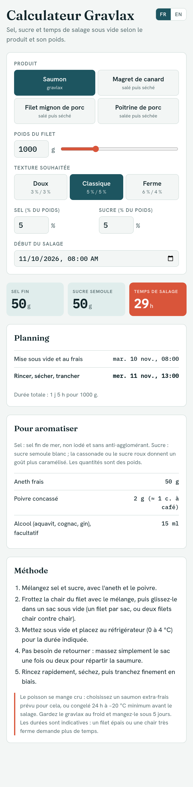
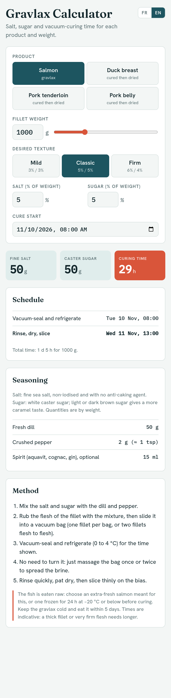

# Calculateur Gravlax

*[English version below](#gravlax-calculator)*

Page web autonome (un seul fichier `index.html`, sans dépendance hormis les polices Google) qui calcule le sel, le sucre et le temps de salage sous vide selon le produit et son poids :

- saumon (gravlax) ;
- magret de canard, filet mignon de porc, poitrine de porc (salés puis séchés, avec planning de séchage).

Pour chaque produit : texture au choix (doux, classique, ferme), pourcentages de sel et de sucre modifiables, planning daté à partir de l'heure de début, aromates dosés selon le poids, méthode pas à pas et précautions sanitaires. Interface en français ou en anglais (boutons FR / EN en haut à droite, choix mémorisé ; `?lang=en` dans l'adresse ouvre directement la version anglaise).

Ouvrir `index.html` dans un navigateur. Les durées sont indicatives.

---

# Gravlax Calculator

Standalone web page (a single `index.html` file, no dependencies apart from Google Fonts) that calculates the salt, sugar and vacuum-curing time for a given product and weight:

- salmon (gravlax);
- duck breast, pork tenderloin, pork belly (cured then air-dried, with a drying schedule).

For each product: choice of texture (mild, classic, firm), adjustable salt and sugar percentages, a dated schedule from the start time, seasonings scaled to the weight, step-by-step method and food-safety notes.

The interface is available in French and English (FR / EN buttons at the top right; the choice is remembered, and `?lang=en` in the address opens the English version directly).

Open `index.html` in a browser. Times are indicative.

